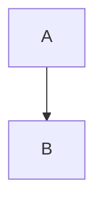
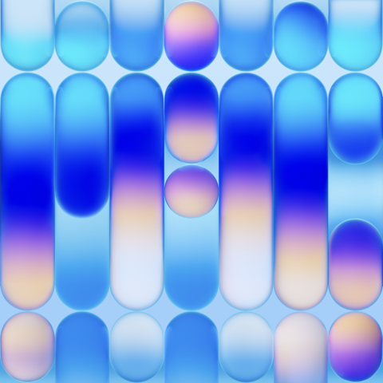

# All Bear styles
## Inline
**bold**, *italic*, ~underline~, ~~strike~~, ==highlight==, `code`, [link](https://bear.app), https://bear.app/auto, [[Wiki Link]], #tag, #nested/tag
Arrows -> <- => <= and color #ff8800 and footnote[^1] and \*escaped\* plus a hard break  
after the break
### Heading 3
#### Heading 4
##### Heading 5
###### Heading 6
Setext H1
=====
Setext H2
-----
## Blocks
> Quote line
> > nested quote

> [!NOTE]
> Note callout

> [!TIP]
> Tip callout

> [!IMPORTANT]
> Important callout

> [!WARNING]
> Warning callout

> [!CAUTION]
> Caution callout

- [ ] open task
- [x] done task
- bullet
	- nested bullet
1. first
2. second

```swift
let answer = 42 // comment
```

    indented code

| Col A | Col B |
|-------|-------|
| a1    | b1    |

$$
E = mc^2
$$

Inline math $x^2 + y^2$





***

[^1]: Footnote text.
